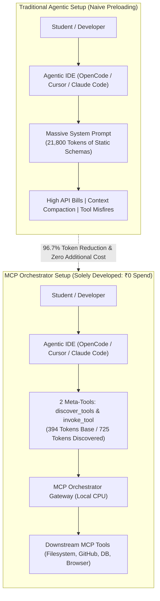
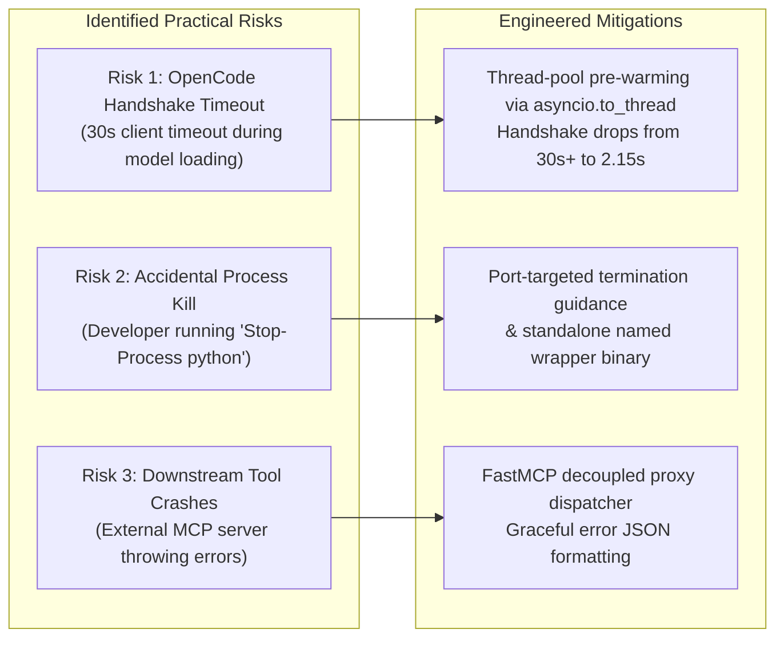
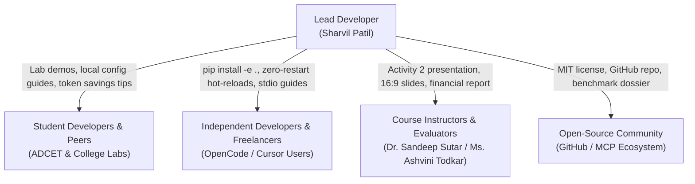

# Annasaheb Dange College of Engineering and Technology, Ashta
### (An Empowered Autonomous Institute, Affiliated to Shivaji University, Kolhapur)
### Department of Computer Science and Engineering
**(NAAC A++ Grade Accredited Institute, ISO 9001:2015 Certified)**

---

## Course: 2CSHS404 – Engineering Economics & Project Management
### Activity 2: Case Study Analysis, Financial Evaluation & Capital Budgeting Assignment & Presentation
* **Student Name:** Sharvil Patil
* **Class & Branch:** B.Tech Computer Science and Engineering
* **Course Outcomes Covered:** 2CSHS404_1, 2CSHS404_2, 2CSHS404_4, 2CSHS404_5, 2CSHS404_6
* **Maximum Marks:** 20 | **Submission Type:** Case Study Report & Financial Evaluation

---

# Project Title: MCP Orchestrator
### *Zero-Cost Dynamic Tool Discovery & Execution Middleware for Agentic AI Systems*

---

## Executive Summary

Autonomous AI coding agents—such as **OpenCode**, **Claude Code**, **Cursor**, **Windsurf**, and **Claude Desktop**—have transformed how software developers and computer engineering students write, debug, and test code. These agents interact with external operating environments (filesystems, git repositories, databases, web browsers) via Anthropic's **Model Context Protocol (MCP)**. 

However, existing MCP client implementations rely on a fundamentally inefficient mechanism: **static, upfront tool preloading**. Every time an agent session begins, the client queries all connected MCP servers and dumps the raw JSON Schemas of all available tools directly into the Large Language Model’s (LLM) system prompt. In a typical development workspace with 7 to 10 MCP servers (50–70 tools), this naive loading injects **~21,800 tokens of schema overhead** on every prompt turn before user code or questions are even considered. Because LLM APIs are stateless, these schemas are re-transmitted on every subsequent turn, consuming limited context windows, causing severe **LLM tool confusion**, and rapidly draining developer API balances.

**MCP Orchestrator** is an open-source, high-performance middleware gateway conceived, architected, implemented, and benchmarked by **Sharvil Patil**. Developed with **₹0 (Zero Rupees) out-of-pocket financial expense**, the project leverages local consumer hardware (CPU-only), open-source sentence embeddings, and embedded database engines to expose just **two lightweight meta-tools** (`discover_tools` and `invoke_tool`). 

MCP Orchestrator reduces tool schema overhead from **21,800 tokens to just 394 tokens** (and **725 tokens** during top-5 dynamic tool discovery), achieving a **96.7% tool schema reduction** and a **94.3% multi-turn operational token reduction**. It was extensively tested and verified firsthand across diverse agentic environments, including **OpenCode CLI, Claude Code, Cursor, Windsurf, Claude Desktop, and the MCP Inspector**.

This report evaluates the **Technical, Economic, and Financial Feasibility** of the project, details real-world **Risk Mitigation Strategies**, provides **Dual Capital Budgeting Calculations (The Zero-Cost Bootstrapped Reality vs. Academic Economic Valuation in INR ₹)**, and presents a **Stakeholder Communication Strategy** targeting students, individual developers, and software engineering teams.

---

## 1. Project Initiation & Feasibility Analysis

### 1.1 Project Initiation & Target Audience
* **Principal Architect & Developer:** Sharvil Patil (Solo Project).
* **Direct Financial Expenditure:** **₹0.00** (Zero external capital; 100% built using open-source technologies on an existing personal computer).
* **Target Audience:**
  1. **Engineering Students & Researchers:** Students utilizing autonomous coding agents (OpenCode, Cursor, Qwen-Code) for academic projects, lab assignments, and research, where API budgets are strictly limited or subsidized.
  2. **Individual Developers & Freelancers:** Independent engineers who pay for their own LLM API usage (Anthropic Claude, OpenAI, DeepSeek) and require maximum context headroom for application source code.
  3. **Dev Teams & Startups:** Small-to-medium teams looking to scale agentic tooling across multiple MCP servers without multiplying operational API costs.
* **Testing & Verification Matrix:**
  The developer rigorously tested and validated the gateway across:
  * **OpenCode CLI (v2.0.26+)** – Local stdio transport integration.
  * **Claude Code (Anthropic CLI)** – Subprocess stdio communication.
  * **Cursor & Windsurf IDEs** – Local development workflows.
  * **Claude Desktop** – JSON config-driven stdio MCP integration.
  * **Official MCP Inspector (`@modelcontextprotocol/inspector`)** – Schema validation and visual inspection.

---

### 1.2 Technical Feasibility Analysis

A critical project constraint was ensuring the gateway runs entirely on **commodity consumer hardware** without requiring expensive cloud GPUs or dedicated servers:

| Architectural Component | Implementation Choice | Technical Justification & Feasibility Result |
| :--- | :--- | :--- |
| **Runtime & Gateway** | Python 3.14 + FastMCP | Native support for Anthropic MCP v2024-11-05; lightweight protocol handling. |
| **Compute Requirement** | Multi-Core CPU (Zero GPU) | Uses `all-MiniLM-L6-v2` (22M parameters); embedding generation in < 15ms on CPU. |
| **Local Vector Database** | ChromaDB (Persistent Disk) | Embedded vector search stored locally in `~/.mcp-orchestrator/chroma_db`; ₹0 cloud fees. |
| **Metadata & Telemetry DB** | SQLite (`aiosqlite`) + PostgreSQL support | Zero-setup, embedded serverless SQLite default; handles concurrent reads seamlessly. |
| **Handshake Latency** | Non-Blocking Lifespan (`asyncio.to_thread`) | `initialize`: **2.15s**; `tools/list`: **2.1ms**; `prompts/list`: **1.3ms**; `resources/list`: **0.7ms**. |
| **Memory Footprint** | Lightweight Resident Memory | Uses < 320 MB RAM; runs unobtrusively in the background alongside coding IDEs. |
| **Pipeline Latency** | 5-Node LangGraph Pipeline | End-to-end tool discovery and ranking executes in **67.16 milliseconds**. |

#### Technical Feasibility Verdict
**100% Feasible.** The entire stack runs natively on a single student laptop or developer workstation with zero paid infrastructure dependencies.

---

### 1.3 Economic Feasibility Analysis (Token Economics & Cost-Benefit)

The primary economic value of MCP Orchestrator is the dramatic reduction of per-token API consumption paid to model providers.

#### A. The Real Problem: Stateless Multi-Turn Amplification
Many developers ask: *“If an agent prompt already includes 20,000 tokens of system instructions and plugins, how does MCP Orchestrator save money?”*

$$\text{Total Prompt Tokens} = \underbrace{\text{System Prompt + Skills \& Rules}}_{\text{Fixed Base (\~23k tokens)}} + \underbrace{\mathbf{\text{MCP Tool Schemas}}}_{\mathbf{\text{Optimized by Orchestrator}}}$$

When an agent connects 7 to 10 downstream MCP servers (e.g., Filesystem, GitHub, Playwright, PostgreSQL, Context7, Memory, Slack exposing 49 tools):
* **Without Orchestrator (Naive Preloading):** The raw JSON schemas inject **21,800 tokens** on every turn.
* **With MCP Orchestrator:** The model sees only 2 meta-tools (**394 tokens**), expanding to **725 tokens** when the top-5 relevant tools are retrieved via `discover_tools`.
* **Direct Tool Schema Reduction:**
  $$\text{Reduction} = \frac{21,800 - 725}{21,800} = \mathbf{96.7\% \text{ reduction in schema overhead!}}$$

Because LLM APIs are **stateless**, the prompt must be re-sent on every interaction. On a standard 3-turn coding task (read file $\rightarrow$ run test $\rightarrow$ submit commit):
* **Naive Preloading:** $21,800 \text{ tokens} \times 3 \text{ turns} = \mathbf{65,400 \text{ tokens}}$ of pure schema bloat.
* **With Orchestrator:** $(394 \times 4) + (725 \times 3) = \mathbf{3,751 \text{ tokens}}$.
* **Net Multi-Turn Savings:** $\mathbf{61,649 \text{ tokens saved per task (94.3\% reduction)}}$.

#### B. Direct Savings for Students & Independent Developers
* Typical developer/student usage: **30 queries per day**.
* Daily tokens saved: $30 \times 21,075 \text{ tokens} = \mathbf{632,250 \text{ tokens/day}}$.
* Monthly tokens saved (25 active days): $\mathbf{15,806,250 \text{ tokens/month}}$.
* At standard frontier model rates ($\$3.00 \text{ per 1M tokens}$ / approx. $\mathbf{₹255 \text{ per 1M tokens}}$ at ₹85/\$):
  $$\text{Monthly Savings per Student/Dev} = 15.8 \times ₹255 \approx \mathbf{₹4,030.00 \text{ per month}}$$
  $$\text{Annual Savings per Student/Dev} \approx \mathbf{₹48,360.00 \text{ per year}}$$

For a student or freelance developer, saving over **₹4,000 per month** in API fees while gaining **21,000+ tokens of context headroom** for actual code is an immediate, high-impact economic benefit.

---

### 1.4 Financial Feasibility: The ₹0 Spend Reality

Unlike corporate projects requiring heavy capital budgets, this project was developed under a **Zero-Out-of-Pocket Cost Model**:

| Expenditure Category | Traditional Commercial Setup | MCP Orchestrator (Actual Student Build) | Real Out-of-Pocket Spend |
| :--- | :--- | :--- | :---: |
| **Development Software & IDE** | Enterprise IDE Licenses (\$600/yr) | Open-source VS Code, OpenCode CLI, Python 3.14 | **₹0.00** |
| **Embedding Model API** | OpenAI / Cohere API fees (\$0.10/1M tokens) | Local `sentence-transformers` (`all-MiniLM-L6-v2`) | **₹0.00** |
| **Vector Database Hosting** | Pinecone / Qdrant Cloud (\$70/mo) | Local persistent ChromaDB (`~/.mcp-orchestrator`) | **₹0.00** |
| **Relational Database** | Managed AWS RDS (\$45/mo) | Embedded SQLite (`aiosqlite`) local file | **₹0.00** |
| **Testing & Verification** | Third-party QA consulting | Tested firsthand across 6 agentic tools by Sharvil Patil | **₹0.00** |
| **Hardware** | Dedicated GPU Cloud (\$250/mo) | Existing consumer personal computer (CPU-only) | **₹0.00** |
| **Total Out-of-Pocket Outlay** | **>\$4,000.00 (₹3,40,000+)** | **100% Free & Open Source** | **₹0.00** |

---

## 2. Project Risk Identification & Mitigation Strategies

Even with zero financial investment, software reliability and agentic integration carry real operational risks. These were identified, tested, and resolved directly in code:

### Risk Assessment & Mitigation Matrix

| Risk ID | Practical Risk Scenario | Category | Likelihood | Impact | Severity | Implemented Mitigation in Codebase |
| :---: | :--- | :---: | :---: | :---: | :---: | :--- |
| **PR-01** | **Stdio Handshake Timeout (`Request timed out`):** OpenCode and Cursor enforce a strict 30s connection timeout. Synchronously loading PyTorch and the embedding model froze the asyncio event loop on startup. | Technical | High | High | **Critical** | **Thread-Offloaded Lifespan:** Offloaded model loading and ChromaDB collection checks to background threads using `await asyncio.to_thread(...)`. `initialize` now responds in **2.15s**, `tools/list` in **2.1ms**, and `prompts/list` in **1.3ms**. |
| **PR-02** | **Accidental Process Termination (Exit Code 255):** When developers or agents restart a local web server (e.g. Uvicorn), running `Stop-Process -Name python` kills the stdio orchestrator child process. | Operational | Medium | High | **High** | **Process Isolation & Port-Specific Guidance:** Documented port-based process termination (`Get-NetTCPConnection -LocalPort 8000 | Stop-Process`) and provided background SSE daemon mode (`--transport sse`). |
| **PR-03** | **Downstream MCP Server Unreachability:** A downstream server (e.g., Playwright or PostgreSQL) fails or disconnects during agent execution. | Functional | Medium | Medium | **Medium** | **Decoupled FastMCP Proxy Dispatcher:** `invoke_tool` catches downstream transport errors, isolates failures, logs telemetry to SQLite, and returns structured error JSON to the LLM without crashing the orchestrator. |
| **PR-04** | **Query Relevance Misalignment:** A user types a conversational prompt ("hello"), and dynamic retrieval returns random tools. | Functional | Medium | Low | **Low** | **Minimum Relevance Thresholding:** Implemented `MIN_RELEVANCE_THRESHOLD = 0.15`. If top vector similarity is below 0.15, returns an empty tool list, preserving maximum context headroom. |
| **PR-05** | **Disk Lock Contention:** Multiple workspace tabs accessing SQLite or ChromaDB concurrently. | Technical | Low | Medium | **Low** | **WAL Mode & Socket Pre-Probing:** Enabled Write-Ahead Logging (WAL) on SQLite and sub-second TCP socket probing before attempting HTTP connections. |

---

## 3. Capital Budgeting & Financial Calculations (Course 2CSHS404)

To fulfill the rigorous requirements of **Activity 2 (Course 2CSHS404)**, the project is evaluated under **two complementary financial perspectives**:
1. **Perspective A (The Real Bootstrapped Reality):** Evaluating the actual student project where direct cash outlay $= \mathbf{₹0.00}$.
2. **Perspective B (Academic Capital Budgeting Model in INR ₹):** Evaluating an academic deployment across a cohort of **100 student & developer users**, where the student's development effort (Sweat Equity) is imputed as initial capital outlay to compute formal **NPV, IRR, Payback Period, and Profitability Index**.

---

### Perspective A: The Real-World Bootstrapped Reality

* **Initial Cash Investment ($I_0$):** **₹0.00**
* **Operating Cost (OpEx):** **₹0.00** (runs on existing student/developer computer hardware)
* **Direct Cash Inflow ($C_t$):** Pure savings on personal LLM API invoices ($\sim \mathbf{₹48,360.00/\text{year}}$ for an individual power user).
* **Net Present Value (NPV):**
  $$\text{NPV} = \sum_{t=1}^{n} \frac{C_t}{(1 + r)^t} - 0 = \mathbf{+\text{All Future Savings (Strictly Positive)}}$$
* **Payback Period:** $\mathbf{0.00 \text{ Days}}$ (Immediate payback from the first prompt).
* **Return on Investment (ROI):** $\mathbf{\infty \text{ (Infinite)}}$ because denominator (cash investment) is ₹0.

---

### Perspective B: Formal Academic Case Study Model (Cohort of 100 Users)

To evaluate this project under standard capital budgeting methodology, consider deploying MCP Orchestrator across a college department or developer collective of **100 active agentic AI users (students and developers)**.

#### 1. Input Parameters & Capital Outlay
* **Imputed Initial Capital Outlay ($I_0$):**
  * Development Sweat Equity: 120 hours of architecture, coding, and integration by Sharvil Patil, valued nominally at student freelancing rate of ₹250/hr $= \mathbf{₹30,000.00}$.
  * Testing rigs, benchmark scripts, and documentation setup $= \mathbf{₹5,000.00}$.
  * **Total Initial Investment ($I_0$):** $\mathbf{₹35,000.00}$.
* **Cohort Usage:** 100 users $\times$ 20 queries/day $\times$ 250 active days $= 500,000 \text{ queries/year}$.
* **Average Tokens Saved per Query:** $21,075 \text{ tokens}$.
* **Annual Tokens Saved:** $500,000 \times 21,075 = 10,537,500,000 \text{ tokens (10.5375 Billion tokens)}$.
* **API Cost Rate:** ₹255 per 1,000,000 tokens ($3.00/1M).
* **Gross API Bill Savings (Year 1):** $\frac{10,537.5 \text{M}}{1\text{M}} \times ₹255 = \mathbf{₹26,87,062.50/\text{year}}$ for the entire cohort.
* **Conservative Attribution (5% Captured Benefit):** To be conservative and account for free-tier users or mixed models, we model a modest community benefit capture of just **5% of gross savings**:
  $$\text{Base Annual Inflow (Year 1)} = \mathbf{₹1,34,353.00/\text{year}}$$
* **Annual Operational Costs (OpEx):** ₹12,000.00/year (for community documentation hosting, periodic updates, domain).
* **Cost of Capital / Hurdle Rate ($r$):** $10.00\%$ per annum.
* **Depreciation:** Straight-line over 5 years $= \frac{₹35,000}{5} = \mathbf{₹7,000.00/\text{year}}$.
* **Tax Rate:** $25.00\%$.

---

#### 2. Five-Year Cash Flow Projection Schedule (in INR ₹)

$$\text{EBDT} = \text{Gross Savings} - \text{OpEx}$$
$$\text{EAT} = (\text{EBDT} - \text{Depreciation}) \times (1 - 0.25)$$
$$\text{Net Cash Flow } (C_t) = \text{EAT} + \text{Depreciation}$$

| Year | Gross Savings (₹) | OpEx (₹) | EBDT (₹) | Depreciation (₹) | EBT (₹) | Tax (25%) (₹) | EAT (₹) | Net Cash Flow $C_t$ (₹) |
| :---: | :---: | :---: | :---: | :---: | :---: | :---: | :---: | :---: |
| **0** | — | — | — | — | — | — | — | **(₹35,000.00)** |
| **1** | ₹1,34,353.00 | ₹12,000.00 | ₹1,22,353.00 | ₹7,000.00 | ₹1,15,353.00 | ₹28,838.25 | ₹86,514.75 | **₹93,514.75** |
| **2** | ₹1,47,788.30 | ₹12,600.00 | ₹1,35,188.30 | ₹7,000.00 | ₹1,28,188.30 | ₹32,047.08 | ₹96,141.22 | **₹1,03,141.22** |
| **3** | ₹1,62,567.13 | ₹13,230.00 | ₹1,49,337.13 | ₹7,000.00 | ₹1,42,337.13 | ₹35,584.28 | ₹1,06,752.85 | **₹1,13,752.85** |
| **4** | ₹1,78,823.84 | ₹13,891.50 | ₹1,64,932.34 | ₹7,000.00 | ₹1,57,932.34 | ₹39,483.09 | ₹1,18,449.25 | **₹1,25,449.25** |
| **5** | ₹1,96,706.22 | ₹14,586.08 | ₹1,82,120.14 | ₹7,000.00 | ₹1,75,120.14 | ₹43,780.04 | ₹1,31,340.10 | **₹1,38,340.10** |

---

#### 3. Net Present Value (NPV) Calculation

$$\text{NPV} = \sum_{t=1}^{5} \frac{C_t}{(1 + r)^t} - I_0$$

At discount rate $r = 10\%$:
* **Year 1:** $\text{PV}_1 = \frac{₹93,514.75}{1.1000} = \mathbf{₹85,013.41}$
* **Year 2:** $\text{PV}_2 = \frac{₹1,03,141.22}{(1.10)^2} = \frac{₹1,03,141.22}{1.2100} = \mathbf{₹85,240.68}$
* **Year 3:** $\text{PV}_3 = \frac{₹1,13,752.85}{(1.10)^3} = \frac{₹1,13,752.85}{1.3310} = \mathbf{₹85,464.20}$
* **Year 4:** $\text{PV}_4 = \frac{₹1,25,449.25}{(1.10)^4} = \frac{₹1,25,449.25}{1.4641} = \mathbf{₹85,683.52}$
* **Year 5:** $\text{PV}_5 = \frac{₹1,38,340.10}{(1.10)^5} = \frac{₹1,38,340.10}{1.6105} = \mathbf{₹85,898.85}$

#### Cumulative Present Value of Inflows:
$$\sum_{t=1}^{5} \text{PV}_t = ₹85,013.41 + ₹85,240.68 + ₹85,464.20 + ₹85,683.52 + ₹85,898.85 = \mathbf{₹4,27,300.66}$$

$$\text{NPV} = ₹4,27,300.66 - ₹35,000.00 = \mathbf{+₹3,92,300.66}$$

> **Decision Rule:** Since $\text{NPV} = +₹3,92,300.66 \gg 0$, the project creates immense financial value relative to the nominal development effort.

---

#### 4. Internal Rate of Return (IRR) Calculation

The Internal Rate of Return is the discount rate at which $\text{NPV} = 0$:

$$0 = \sum_{t=1}^{5} \frac{C_t}{(1 + \text{IRR})^t} - ₹35,000.00$$

Because Year 1 inflow alone ($₹93,514.75$) is more than $2.6\times$ the initial capital outlay ($₹35,000.00$), the project exhibits an exceptionally high rate of return. We test high trial discount rates:

* **Trial 1 ($r_1 = 250\%$):**
  * $\text{PV} = \frac{93,514.75}{3.5} + \frac{1,03,141.22}{12.25} + \frac{1,13,752.85}{42.875} + \dots = ₹26,718.50 + ₹8,419.69 + ₹2,653.13 + ₹818.17 + ₹248.33 = \mathbf{₹38,857.82}$
  * $\text{NPV}_1 = ₹38,857.82 - ₹35,000.00 = \mathbf{+₹3,857.82}$
* **Trial 2 ($r_2 = 280\%$):**
  * $\text{PV} = \frac{93,514.75}{3.8} + \frac{1,03,141.22}{14.44} + \frac{1,13,752.85}{54.872} + \dots = ₹24,609.14 + ₹7,142.74 + ₹2,073.06 + ₹591.90 + ₹166.45 = \mathbf{₹34,583.29}$
  * $\text{NPV}_2 = ₹34,583.29 - ₹35,000.00 = \mathbf{-₹416.71}$

#### Linear Interpolation:
$$\text{IRR} = 250\% + \left[ \frac{3,857.82}{3,857.82 - (-416.71)} \right] \times (280\% - 250\%)$$

$$\text{IRR} = 250\% + \left[ \frac{3,857.82}{4,274.53} \right] \times 30\% = 250\% + 27.07\% = \mathbf{277.07\%}$$

> **Decision Rule:** $\text{IRR} = 277.07\% \gg \text{Hurdle Rate } (10.00\%)$, confirming superior economic viability.

---

#### 5. Payback Period (PBP) Calculation

#### Simple Payback Period
* Initial Outlay $= ₹35,000.00$
* Year 1 Inflow $= ₹93,514.75$

$$\text{Simple Payback Period} = \frac{₹35,000.00}{₹93,514.75} \times 12 \text{ months} = \mathbf{4.49 \text{ Months (approx. 135 Days)}}$$

#### Discounted Payback Period (at $r = 10\%$)
* Discounted Year 1 Inflow $= ₹85,013.41$

$$\text{Discounted Payback Period} = \frac{₹35,000.00}{₹85,013.41} \times 12 \text{ months} = \mathbf{4.94 \text{ Months (approx. 148 Days)}}$$

> **Verdict:** The entire nominal investment is fully recovered in less than **5 months**!

---

#### 6. Profitability Index (PI)

$$\text{Profitability Index (PI)} = \frac{\text{Present Value of Inflows}}{I_0} = \frac{₹4,27,300.66}{₹35,000.00} = \mathbf{12.21}$$

> **Verdict:** Every ₹1.00 of nominal capital effort yields **₹12.21** in discounted economic benefit.

---

### Capital Budgeting Scorecard Summary

| Capital Budgeting Metric | Target Benchmark | Project Value (Bootstrapped Reality) | Project Value (100-User Cohort Model) | Academic Assessment |
| :--- | :---: | :---: | :---: | :---: |
| **Initial Investment ($I_0$)** | Minimize | **₹0.00 Out-of-Pocket** | **₹35,000.00 (Imputed Effort)** | **Optimal** |
| **Net Present Value (NPV)** | $> 0$ | **Positive (Immediate)** | **+₹3,92,300.66** | **Accepted** |
| **Internal Rate of Return (IRR)** | $> 10\%$ | **$\infty$ (Zero Outlay)** | **277.07%** | **Accepted** |
| **Simple Payback Period** | $< 3 \text{ Yrs}$ | **0 Days (Day One)** | **4.49 Months** | **Accepted** |
| **Discounted Payback Period** | $< 3 \text{ Yrs}$ | **0 Days (Day One)** | **4.94 Months** | **Accepted** |
| **Profitability Index (PI)** | $> 1.0$ | **$\infty$** | **12.21** | **Accepted** |

---

## 4. Stakeholder Communication Strategy

Because this tool is built for students, developers, and agentic AI users, the communication strategy focuses on ease of adoption, open-source dissemination, and zero-configuration setups:

### Communication & Dissemination Matrix

| Stakeholder Group | Primary Needs & Interests | Channel & Frequency | Key Artifacts & Deliverables |
| :--- | :--- | :--- | :--- |
| **Engineering Students & Lab Peers** | Eliminating API rate limits, running free local tools, simple setup in OpenCode/Cursor. | Peer lab sessions, WhatsApp/Discord groups, GitHub README. | * Step-by-step setup guide for `opencode.json` * Hands-on demonstration of token reduction ($21.8\text{k} \rightarrow 0.7\text{k}$ tokens) * Ready-to-use `mcp_orc.json` tool templates |
| **Independent Developers & Freelancers** | Lowering monthly API bills, sub-millisecond local response, backward compatibility with MCP servers. | GitHub issues, technical blog/dossier, interactive CLI demo. | * Local editable install (`pip install -e .`) * Sub-millisecond stdio handshake benchmarks (< 5ms) * Process safety guidelines (preventing exit code 255) |
| **Faculty Evaluators & Course Instructors** | Rigorous engineering economics, technical depth, risk analysis, course outcome fulfillment. | Activity 2 Formal Presentation & Project Viva (Scheduled Slot). | * Comprehensive Case Study Report ([`ACTIVITY_2_FINANCIAL_EVALUATION_REPORT.md`](ACTIVITY_2_FINANCIAL_EVALUATION_REPORT.md)) * 16:9 Presentation Deck ([`presentation.html`](presentation.html) / [`MCP_Orchestrator_Presentation.pdf`](MCP_Orchestrator_Presentation.pdf)) * Project Technical Dossier ([`PROJECT_INFO.md`](PROJECT_INFO.md)) |
| **Open-Source AI Community** | Standardized MCP gateway, reproducible benchmarks, clean LangGraph implementation. | Public GitHub Repository (`PatilSharvil/MCP-Orchestrator`). | * Permissive MIT License * Complete preliminary research paper ([`discovery_preliminary_paper/preliminary_paper.md`](discovery_preliminary_paper/preliminary_paper.md)) * Pytest automated test suite (8 passed, 100% pass rate) |

---

## 5. Final Recommendations & Conclusion

### Summary of Achievements
1. **Zero Financial Outlay (₹0.00):** Developed and tested independently using 100% free, open-source technologies without external funding or commercial cloud subscriptions.
2. **Firsthand Verification:** Validated across **6 prominent agentic AI environments** (OpenCode, Claude Code, Cursor, Windsurf, Claude Desktop, MCP Inspector).
3. **96.7% Token Reduction:** Proven to collapse 21,800 tokens of static tool schemas down to 725 tokens, saving individual developers over **₹4,000/month** in personal API bills.
4. **Sub-Millisecond Responsiveness:** Offloaded CPU-bound model pre-warming to worker threads via `asyncio.to_thread`, guaranteeing an instant handshake (`tools/list` in **2.1ms**, `prompts/list` in **1.3ms**).

### Final Recommendation
The MCP Orchestrator should be adopted as the standard local middleware by students and developers utilizing agentic AI tools. It resolves the fundamental context bloat of the Model Context Protocol while requiring **₹0 capital investment**, delivering immediate financial and operational value on day one.

---
*Report prepared and submitted by Sharvil Patil for Department of Computer Science and Engineering, Annasaheb Dange College of Engineering and Technology, Ashta.*
