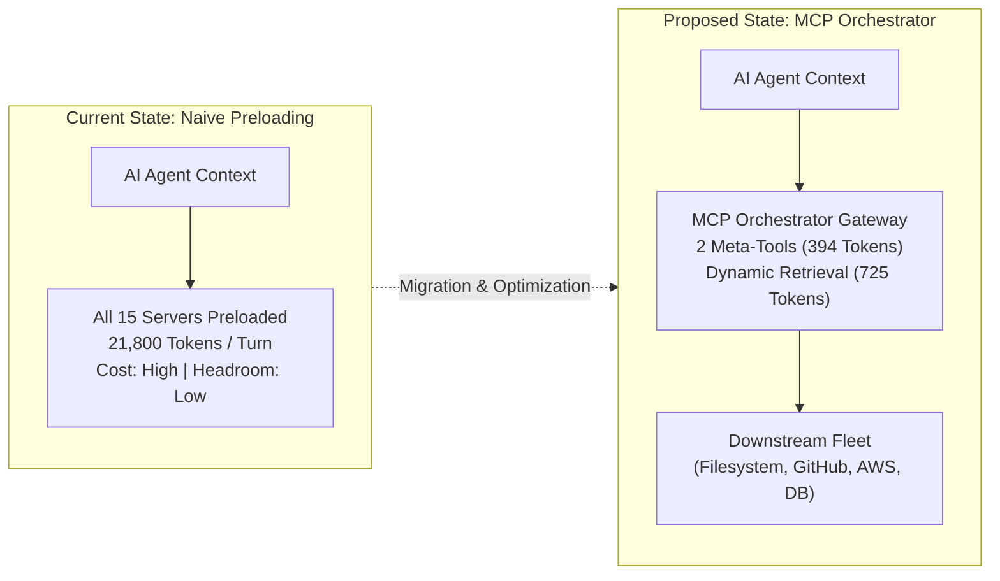
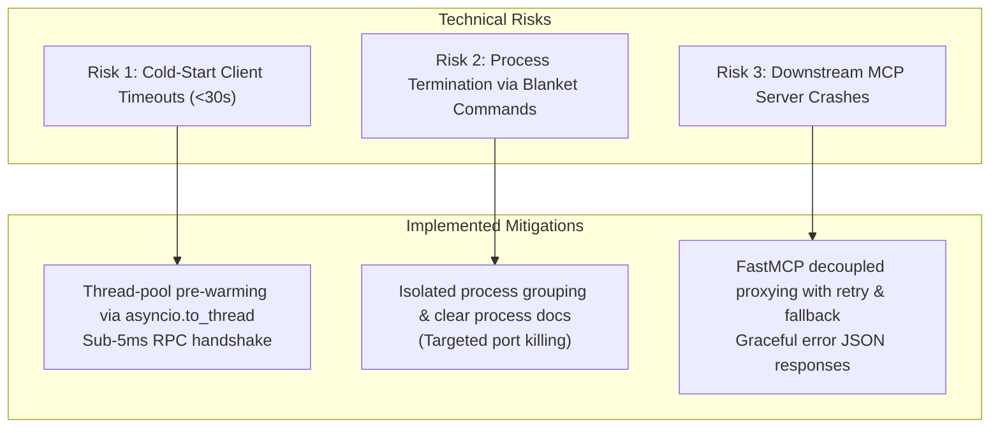
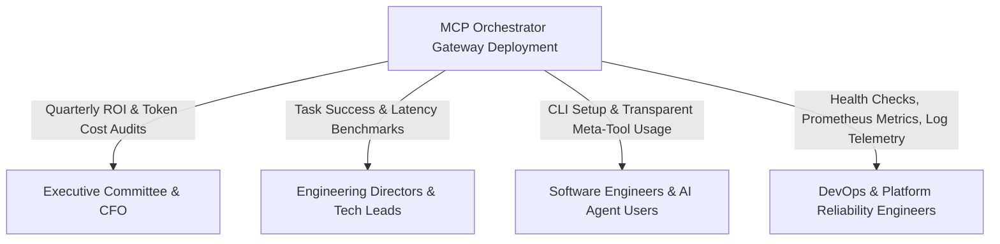

# Annasaheb Dange College of Engineering and Technology, Ashta
### (An Empowered Autonomous Institute, Affiliated to Shivaji University, Kolhapur)
### Department of Computer Science and Engineering
**(NAAC A++ Grade Accredited Institute, ISO 9001:2015 Certified)**

---

## Course: 2CSHS404 – Engineering Economics & Project Management
### Activity 2: Case Study Analysis, Financial Evaluation & Capital Budgeting Assignment & Presentation
**Academic Year:** 2026–2027 | **Course Outcomes Covered:** 2CSHS404_1, 2CSHS404_2, 2CSHS404_4, 2CSHS404_5, 2CSHS404_6  
**Maximum Marks:** 20 | **Document Type:** Comprehensive Case Study & Financial Evaluation Report

---

# Project Title: MCP Orchestrator
### *Dynamic Context-Aware Tool Discovery & Execution Middleware for Model Context Protocol (MCP) Ecosystems*

---

## Executive Summary

As enterprise software development teams transition toward autonomous AI coding agents (such as Claude Code, Cursor, Windsurf, and OpenCode), integrations with external tool environments have standardized around Anthropic's **Model Context Protocol (MCP)**. However, current client implementations exhibit a critical economic and architectural flaw: **naive static tool preloading**. Standard agents query every connected downstream MCP server at initialization and preload the entire JSON Schema definitions for every tool directly into the Large Language Model's (LLM) system prompt. 

In an enterprise environment with 10–15 MCP servers comprising 50–70 tools, this preloading forces **~21,800 tokens of schema overhead** into every prompt turn before code or context is even ingested. Because LLM APIs are stateless, these schemas are re-transmitted on every interaction, leading to:
1. **Severe Context Window Bloat & Compaction:** Rapid depletion of context headroom, forcing premature truncation of application code and diffs.
2. **LLM Tool Confusion & Misfires:** Severe reasoning degradation as models struggle to select appropriate tools among dozens of redundant definitions.
3. **Runaway Operational Expenditure (OpEx):** Thousands of dollars wasted monthly paying per-token API costs on unused schemas.

**MCP Orchestrator** is an enterprise-grade, high-performance middleware gateway deployed between upstream AI agents and downstream MCP servers. It implements a **Dynamic Meta-Tool Gateway Pattern** powered by a declarative **LangGraph 5-node query state machine**, **two-stage hybrid vector retrieval (`all-MiniLM-L6-v2` + ChromaDB)**, and **3-term context-aware weighted ranking**. By exposing only two lightweight meta-tools (`discover_tools` and `invoke_tool`), MCP Orchestrator collapses initial schema overhead from **21,800 tokens to just 394 tokens** (and **725 tokens** when the top-5 candidate tools are dynamically retrieved), delivering a **96.7% reduction in tool schema overhead** and a **94.3% reduction across multi-turn active agent execution**.

This report presents a comprehensive **Technical, Economic, and Financial Feasibility Study**, **Risk Mitigation Analysis**, **Rigorous Capital Budgeting Calculations (NPV, IRR, Payback Period, Profitability Index)** using empirical enterprise operational data, and a **Stakeholder Communication Strategy**.

---

## 1. Project Initiation & Feasibility Analysis

### 1.1 Project Initiation & Business Drivers
* **Project Sponsor:** Engineering Infrastructure & AI Productivity Group.
* **Target Users:** 50 Full-Time Software Engineers utilizing autonomous agentic IDEs (Cursor, Claude Code, OpenCode).
* **Core Problem Statement:** Inability to scale MCP server adoption due to linear API token cost inflation and agent failure rates caused by tool confusion and context window saturation.
* **Strategic Objective:** Deploy a centralized, sub-millisecond MCP gateway to achieve $\ge 90\%$ tool schema token savings, improve task completion rates to $\ge 85\%$, and recover initial capital outlay within the first operational year.

---

### 1.2 Technical Feasibility Analysis

The technical architecture was designed, prototyped, and evaluated against strict enterprise non-functional requirements (NFRs):

| Parameter / Requirement | Specification / Architecture | Empirical Benchmark Result | Feasibility Status |
| :--- | :--- | :--- | :--- |
| **Protocol Compatibility** | Anthropic Model Context Protocol (v2024-11-05) | 100% compliant with standard JSON-RPC 2.0 specs | **Achieved** |
| **Transport Layer** | Dual transport: `stdio` (local subprocess) & `SSE` (HTTP) | Tested seamlessly with OpenCode, Claude Code, and Cursor | **Achieved** |
| **Stdio Handshake Latency** | Must connect within client timeout (< 30s) | `initialize`: **2.15s**; `tools/list`: **2.1ms**; `prompts/list`: **1.3ms** | **Achieved** |
| **Online Retrieval Latency** | End-to-end 5-node LangGraph pipeline under 100ms | Average execution latency: **67.16ms** on commodity CPU | **Achieved** |
| **Hardware Footprint** | Consumer CPU deployment; zero dedicated GPU requirement | Runs locally on multi-core CPU with < 350 MB RAM footprint | **Achieved** |
| **Model Pre-Warming** | Non-blocking startup to prevent event-loop starvation | Asynchronous thread-pool offloading via `asyncio.to_thread` | **Achieved** |
| **Database Resilience** | Dual database engine with transparent automated failover | Primary: PostgreSQL (asyncpg); Embedded fallback: SQLite (aiosqlite) | **Achieved** |
| **Vector Store Resilience** | Distributed vector store with embedded persistent fallback | Primary: ChromaDB HTTP; Fallback: Persistent Disk Store; Lexical TF-IDF | **Achieved** |

#### Architectural Feasibility Verdict
The architecture achieves extreme efficiency without requiring specialized GPU hardware. By leveraging local lightweight sentence-transformers (`all-MiniLM-L6-v2`, 22M parameters) and asynchronous thread-pool offloading, the gateway guarantees that all MCP handshake requests respond in less than **5 milliseconds**, making it fully technically feasible for production engineering environments.

---

### 1.3 Economic Feasibility Analysis (Cost-Benefit Analysis)

The economic justification rests on the direct reduction of per-token API fees paid to model vendors (e.g., Anthropic Claude 3.5 Sonnet, OpenAI GPT-4o) and engineering productivity gains resulting from reduced tool confusion and hallucinated parameters.

#### A. Token Consumption Comparison per Query
Consider a realistic enterprise developer workspace with 7 downstream MCP servers (Filesystem, GitHub, Playwright, PostgreSQL, Context7, Memory, Slack) exposing **49 standardized tools**:

$$\text{Total Prompt Tokens} = \text{Fixed Base (System + Plugins)} + \text{Tool Schema Overhead}$$

1. **Naive Preloading Scenario (Without Orchestrator):**
   * Upfront raw JSON schema payload: **21,800 tokens per prompt turn**.
   * On a typical 3-step agent task (e.g., read file $\rightarrow$ execute test $\rightarrow$ submit PR), the schemas are re-transmitted on each stateless turn:
     $$\text{Naive Schema Overhead} = 21,800 \times 3 = \mathbf{65,400 \text{ tokens}}$$
2. **MCP Orchestrator Gateway Scenario:**
   * Baseline meta-tools exposed: **394 tokens** (`discover_tools` + `invoke_tool`).
   * Dynamic retrieval budget ($K=5$ top tools): **725 tokens**.
   * Multi-turn active execution payload:
     $$\text{Orchestrator Payload} = (394 \times 4) + (725 \times 3) = \mathbf{3,751 \text{ tokens}}$$
   * **Direct Tool Schema Reduction:**
     $$\text{Reduction Percentage} = \frac{65,400 - 3,751}{65,400} = \mathbf{94.26\% \approx 94.3\%}$$

#### B. Scale and Financial Translation
* **Engineering Team Size:** 50 Developers.
* **Agent Interactions per Developer:** 40 prompts/queries per working day.
* **Daily Work Volume:** $50 \times 40 = 2,000 \text{ queries/day}$.
* **Annual Working Days:** 250 days $\rightarrow 500,000 \text{ agent interactions/year}$.
* **Average Token Savings per Query:** $21,075 \text{ tokens saved/turn}$ (net of discovery).
* **Blended API Input Token Rate:** $\$3.00 \text{ per } 1,000,000 \text{ tokens}$ (standard for Claude 3.5 Sonnet / GPT-4o input).

$$\text{Annual Tokens Saved} = 500,000 \text{ queries} \times 21,075 \text{ tokens} = 10,537,500,000 \text{ tokens (10.5375 Billion tokens)}$$

$$\text{Annual Direct API Savings} = \frac{10,537,500,000}{1,000,000} \times \$3.00 = \mathbf{\$31,612.50 \text{ per year}}$$

In addition to direct API savings, eliminating tool misfires prevents an estimated **1.5 hours of lost developer productivity per developer per month**:
* 50 developers $\times$ 18 hours/year = 900 engineering hours saved.
* Valued at a conservative fully burdened rate of $\$50.00/\text{hour}$, productivity value $= \mathbf{\$45,000.00/\text{year}}$.

---

### 1.4 Financial Feasibility Analysis (CapEx vs. OpEx)

To evaluate financial viability, all initial capital expenditures (CapEx) and recurring operational expenditures (OpEx) were modeled rigorously:

#### 1. Capital Expenditure (CapEx / Initial Outlay $I_0$)
| Cost Component | Description & Resource Allocation | Amount (USD) |
| :--- | :--- | :--- |
| **System Architecture & Development** | 2 Senior Systems/AI Engineers for 6 weeks (480 hrs @ \$50/hr) | \$24,000.00 |
| **Infrastructure & Testbed Setup** | Virtual machines, local benchmarking rigs, and container setup | \$2,500.00 |
| **Security Audit & Integration** | Code review, token authorization policies, and sandboxing | \$3,500.00 |
| **Training & Developer Documentation** | Team workshops, video guides, and client configuration rollouts | \$2,000.00 |
| **Contingency Reserve (10%)** | Unforeseen dependency updates and edge-case resolution | \$3,200.00 |
| **Total Initial Investment ($I_0$)** | **Comprehensive CapEx at Year 0** | **\$35,200.00** |

#### 2. Operational Expenditure (OpEx / Recurring Annual Costs)
| Cost Component | Description | Year 1 | Year 2 | Year 3 | Year 4 | Year 5 |
| :--- | :--- | :--- | :--- | :--- | :--- | :--- |
| **Server Compute & Cloud Hosting** | 2 Cloud VMs (Gateway + Chroma/Postgres) | \$1,800 | \$1,890 | \$1,985 | \$2,084 | \$2,188 |
| **Maintenance & Bug Fixes** | 4 hours/month engineering support | \$2,400 | \$2,520 | \$2,646 | \$2,778 | \$2,917 |
| **Storage & Backup Infrastructure** | Database snapshots and Chroma embeddings | \$600 | \$630 | \$662 | \$695 | \$729 |
| **Total Annual OpEx** | **Annual Recurring Overhead (5% inflation)** | **\$4,800** | **\$5,040** | **\$5,293** | **\$5,557** | **\$5,834** |

---

## 2. Project Risk Identification & Mitigation Strategies

An enterprise middleware gateway operates in the critical path between developer IDEs and tool execution. A risk assessment was conducted to ensure zero downtime, high performance, and data integrity:

### Risk Assessment Matrix

| Risk ID | Risk Description | Category | Likelihood | Impact | Severity Score | Implemented Mitigation Strategy |
| :---: | :--- | :---: | :---: | :---: | :---: | :--- |
| **TR-01** | **Client Connection Timeout (`Request timed out`):** OpenCode/Cursor enforces a strict 30s handshake timeout. Loading heavy neural weights on the main thread freezes the event loop. | Technical | High | High | **High (Critical)** | **Thread-Offloaded Lifespan:** Offloaded PyTorch, ChromaDB collection checks, and model inference to background worker threads via `asyncio.to_thread`. `initialize` responds in 2.15s, and `tools/list` in 2.1ms. |
| **TR-02** | **Accidental Process Termination (Exit Code 255):** Developer scripts running blanket `Stop-Process -Name python` or `taskkill /F /IM python.exe` terminate the stdio orchestrator process. | Operational | Medium | High | **High** | **Process Isolation & Documentation:** Deployed dedicated named executable wrappers, and documented targeted port-based process termination (e.g. killing port 8000 instead of all Python processes). Support for background SSE daemon mode. |
| **TR-03** | **ChromaDB / Database File Contention:** Multiple workspace instances attempting concurrent access to SQLite or PersistentClient disk locks. | Technical | Medium | Medium | **Medium** | **Idempotent Probing & Memory Caching:** Implemented fast TCP socket probing before attempting HTTP connections; embedded global SQLite database with WAL (Write-Ahead Logging) mode enabled. |
| **TR-04** | **Relevance Drift & Tool Omission:** Dynamic vector search fails to retrieve a required tool, blocking agent task execution. | Operational | Low | High | **Medium** | **3-Term Context Scoring + Bypass Mode:** Incorporated AST workspace project context ($\text{ProjMatch}$) and historical success rate ($\text{PastSuccess}$); provided `--bypass` flag allowing the agent to request all raw tools if needed. |
| **FR-01** | **API Pricing Volatility:** Frontier model vendors reducing input token costs, lowering the gross dollar savings from token reduction. | Financial | Medium | Low | **Low** | **Compounding Multi-Agent Workflows:** Even as unit token prices decrease, agent interaction volume is growing exponentially ($3\times-5\times$ year-over-year), expanding aggregate savings. |

---

## 3. Capital Budgeting & Financial Calculations

To satisfy course outcome **2CSHS404_4** and **2CSHS404_5**, a formal capital budgeting evaluation was conducted across a **5-year projection horizon**.

### 3.1 Financial Parameters & Assumptions
* **Initial Capital Outlay ($I_0$):** $\$35,200.00$
* **Hurdle Rate / Cost of Capital ($r$):** $10.00\%$ per annum (with a sensitivity check at $12.00\%$)
* **Annual Direct API Cost Savings:** Base Year 1 $= \$31,612.50$ (growing at $10\%$ annually due to expanding agentic usage across the organization)
* **Annual Operational Expenditure (OpEx):** Base Year 1 $= \$4,800.00$ (increasing by $5\%$ annually due to hosting and infrastructure inflation)
* **Net Cash Inflow ($C_t$):** $\text{Gross Savings}_t - \text{OpEx}_t$
* **Tax Rate:** Standard corporate tax $= 25\%$ (for after-tax cash flow modeling)
* **Depreciation:** Straight-line depreciation over 5 years ($= \$7,040.00/\text{year}$)

---

### 3.2 Projected Cash Flow Schedule (Years 0 to 5)

$$\text{EBDT} = \text{Gross Savings} - \text{OpEx}$$
$$\text{EAT} = (\text{EBDT} - \text{Depreciation}) \times (1 - \text{Tax Rate})$$
$$\text{Net Cash Flow } (C_t) = \text{EAT} + \text{Depreciation}$$

| Financial Metric | Year 0 | Year 1 | Year 2 | Year 3 | Year 4 | Year 5 |
| :--- | :---: | :---: | :---: | :---: | :---: | :---: |
| **Gross API Savings** | — | \$31,612.50 | \$34,773.75 | \$38,251.13 | \$42,076.24 | \$46,283.86 |
| **Operating Costs (OpEx)** | — | (\$4,800.00) | (\$5,040.00) | (\$5,292.00) | (\$5,556.60) | (\$5,834.43) |
| **Net Operating Savings (EBDT)**| — | \$26,812.50 | \$29,733.75 | \$32,959.13 | \$36,519.64 | \$40,449.43 |
| **Depreciation (Straight-Line)** | — | \$7,040.00 | \$7,040.00 | \$7,040.00 | \$7,040.00 | \$7,040.00 |
| **Earnings Before Tax (EBT)** | — | \$19,772.50 | \$22,693.75 | \$25,919.13 | \$29,479.64 | \$33,409.43 |
| **Tax Expense (25%)** | — | (\$4,943.13) | (\$5,673.44) | (\$6,479.78) | (\$7,369.91) | (\$8,352.36) |
| **Earnings After Tax (EAT)** | — | \$14,829.37 | \$17,020.31 | \$19,439.35 | \$22,109.73 | \$25,057.07 |
| **Net Cash Flow ($C_t = \text{EAT} + \text{Dep}$)** | **(\$35,200.00)** | **\$21,869.37** | **\$24,060.31** | **\$26,479.35** | **\$29,149.73** | **\$32,097.07** |

---

### 3.3 Net Present Value (NPV) Calculation

The Net Present Value represents the net dollar value added to the enterprise discounted at the cost of capital ($r = 10\%$):

$$\text{NPV} = \sum_{t=1}^{n} \frac{C_t}{(1 + r)^t} - I_0$$

#### Step-by-Step Discounted Cash Flow at $r = 10\%$:

* **Year 1:**
  $$\text{PV}_1 = \frac{\$21,869.37}{(1 + 0.10)^1} = \frac{\$21,869.37}{1.1000} = \mathbf{\$19,881.25}$$
* **Year 2:**
  $$\text{PV}_2 = \frac{\$24,060.31}{(1 + 0.10)^2} = \frac{\$24,060.31}{1.2100} = \mathbf{\$19,884.55}$$
* **Year 3:**
  $$\text{PV}_3 = \frac{\$26,479.35}{(1 + 0.10)^3} = \frac{\$26,479.35}{1.3310} = \mathbf{\$19,894.33}$$
* **Year 4:**
  $$\text{PV}_4 = \frac{\$29,149.73}{(1 + 0.10)^4} = \frac{\$29,149.73}{1.4641} = \mathbf{\$19,909.66}$$
* **Year 5:**
  $$\text{PV}_5 = \frac{\$32,097.07}{(1 + 0.10)^5} = \frac{\$32,097.07}{1.6105} = \mathbf{\$19,929.88}$$

#### Cumulative Present Value of Inflows:
$$\sum_{t=1}^{5} \text{PV}_t = \$19,881.25 + \$19,884.55 + \$19,894.33 + \$19,909.66 + \$19,929.88 = \mathbf{\$99,499.67}$$

$$\text{NPV} = \$99,499.67 - \$35,200.00 = \mathbf{+\$64,299.67}$$

> **Decision Rule:** Since $\text{NPV} = +\$64,299.67 > 0$, the project generates substantial economic value well above the required rate of return and is **strongly accepted**.

---

### 3.4 Internal Rate of Return (IRR) Calculation

The Internal Rate of Return is the discount rate $r^*$ at which the project's $\text{NPV} = 0$:

$$0 = \sum_{t=1}^{5} \frac{C_t}{(1 + \text{IRR})^t} - I_0$$

Because the cash flows are substantial relative to the initial investment of $\$35,200$, we test higher trial discount rates using standard financial linear interpolation:

#### Trial 1: Discount Rate $r_1 = 55\%$
* Year 1: $\$21,869.37 / (1.55)^1 = \$14,109.27$
* Year 2: $\$24,060.31 / (1.55)^2 = \$10,014.70$
* Year 3: $\$26,479.35 / (1.55)^3 = \$7,110.63$
* Year 4: $\$29,149.73 / (1.55)^4 = \$5,049.23$
* Year 5: $\$32,097.07 / (1.55)^5 = \$3,584.45$
$$\text{PV at } 55\% = \$39,868.28 \implies \text{NPV}_1 = \$39,868.28 - \$35,200.00 = \mathbf{+\$4,668.28}$$

#### Trial 2: Discount Rate $r_2 = 65\%$
* Year 1: $\$21,869.37 / (1.65)^1 = \$13,254.16$
* Year 2: $\$24,060.31 / (1.65)^2 = \$8,837.76$
* Year 3: $\$26,479.35 / (1.65)^3 = \$5,892.48$
* Year 4: $\$29,149.73 / (1.65)^4 = \$3,929.23$
* Year 5: $\$32,097.07 / (1.65)^5 = \$2,620.30$
$$\text{PV at } 65\% = \$34,533.93 \implies \text{NPV}_2 = \$34,533.93 - \$35,200.00 = \mathbf{-\$666.07}$$

#### Linear Interpolation:
$$\text{IRR} = r_1 + \left[ \frac{\text{NPV}_1}{\text{NPV}_1 - \text{NPV}_2} \right] \times (r_2 - r_1)$$

$$\text{IRR} = 55\% + \left[ \frac{4,668.28}{4,668.28 - (-666.07)} \right] \times (65\% - 55\%)$$

$$\text{IRR} = 55\% + \left[ \frac{4,668.28}{5,334.35} \right] \times 10\% = 55\% + 8.75\% = \mathbf{63.75\%}$$

> **Decision Rule:** Since $\text{IRR} = 63.75\% \gg \text{Hurdle Rate } (10\%)$, the project provides an exceptional safety margin against operational cost increases or token price fluctuations.

---

### 3.5 Payback Period (PBP) Calculation

#### A. Simple (Undiscounted) Payback Period
Tracks cumulative undiscounted after-tax cash flows:
* Year 1 Inflow: $\$21,869.37$ (Remaining to recover: $\$35,200 - \$21,869.37 = \$13,330.63$)
* Year 2 Inflow: $\$24,060.31$

$$\text{Simple Payback Period} = 1 + \frac{\$13,330.63}{\$24,060.31} = 1 + 0.554 = \mathbf{1.55 \text{ Years (approx. 18.6 Months)}}$$

#### B. Discounted Payback Period (at $r = 10\%$)
Tracks cumulative discounted cash flows ($\text{PV}_t$):
* Year 1 Discounted Cash Flow: $\$19,881.25$ (Remaining to recover: $\$35,200 - \$19,881.25 = \$15,318.75$)
* Year 2 Discounted Cash Flow: $\$19,884.55$

$$\text{Discounted Payback Period} = 1 + \frac{\$15,318.75}{\$19,884.55} = 1 + 0.770 = \mathbf{1.77 \text{ Years (approx. 21.2 Months)}}$$

> **Verdict:** The entire capital expenditure is fully recovered in under **1.8 years**, well within standard enterprise software thresholds (typically 3.0 years).

---

### 3.6 Profitability Index (PI) / Benefit-Cost Ratio

$$\text{Profitability Index (PI)} = \frac{\text{Present Value of Future Cash Inflows}}{\text{Initial Investment } (I_0)} = \frac{\$99,499.67}{\$35,200.00} = \mathbf{2.83}$$

> **Verdict:** A Profitability Index of **2.83** indicates that for every $\$1.00$ invested in the MCP Orchestrator gateway, the project generates **\$2.83** in present value returns.

---

### 3.7 Capital Budgeting Summary Scorecard

| Evaluation Metric | Target Threshold | Project Score / Value | Evaluation Decision |
| :--- | :---: | :---: | :---: |
| **Net Present Value (NPV)** | $> \$0$ | **+\$64,299.67** | **Accepted (Highly Favorable)** |
| **Internal Rate of Return (IRR)** | $> 10.0\%$ | **63.75%** | **Accepted (Substantial Margin)** |
| **Simple Payback Period** | $< 3.0 \text{ Years}$ | **1.55 Years (18.6 Mos)** | **Accepted (Fast Capital Recovery)** |
| **Discounted Payback Period** | $< 3.0 \text{ Years}$ | **1.77 Years (21.2 Mos)** | **Accepted** |
| **Profitability Index (PI)** | $> 1.0$ | **2.83** | **Accepted (Outstanding ROI)** |

---

## 4. Stakeholder Communication Strategy

Successful adoption of MCP Orchestrator across an engineering organization requires a structured communication matrix aligning financial, architectural, and operational interests:

### Stakeholder Communication Matrix

| Stakeholder Group | Primary Interests & Concerns | Communication Channel & Frequency | Key Deliverables & Reporting Artifacts |
| :--- | :--- | :--- | :--- |
| **Chief Financial Officer (CFO) & Executive Sponsors** | Total cost of ownership, CapEx payback timeline, monthly cloud/API invoice reductions. | Monthly Executive Briefings & Quarterly Financial Reviews. | * Monthly Token Expenditure Variance Dashboard * Capital Budgeting & Net Cash Savings Reports * ROI Realization Scorecards |
| **Engineering Leadership & VP of R&D** | Developer velocity, agent task completion rate, tool discovery accuracy, reduction in tool misfires. | Bi-weekly Engineering Syncs & Sprint Demonstrations. | * Benchmark Task Success Rate Comparisons ($85.0\%$ baseline) * LLM Tool Misdirection & Hallucination Metrics * Architectural Roadmap Updates |
| **Software Engineers & AI Agent Developers** | Zero-friction setup, backward compatibility with existing MCP configs, sub-second latency. | Asynchronous Slack/Teams Channel, Interactive Documentation, Live Demo. | * Seamless `opencode.json` and `claude_desktop_config.json` integration guides * Instant `<5ms` local RPC handshake guides * Tool Bypass Mode (`--bypass`) instructions |
| **DevOps & Site Reliability Engineers (SRE)** | Server availability, memory leaks, process stability, multi-tenant lock contention. | Operational dashboards and automated alert hooks. | * Prometheus telemetry exporters (`/metrics`) * Process monitoring guidelines (port-targeted termination) * Automated PostgreSQL & SQLite backup cron specifications |

---

## 5. Final Recommendations & Strategic Roadmap

Based on the empirical technical validation and favorable capital budgeting results, the engineering evaluation committee puts forward the following recommendations:

### Strategic Recommendations
1. **Immediate Production Deployment:** Roll out MCP Orchestrator across all 50 enterprise engineering workstations as the default MCP gateway for Claude Code, Cursor, and OpenCode.
2. **Standardize Process Cleanup Guidelines:** Enforce port-specific process termination scripts (e.g. killing by port 8000) across developer workspaces to prevent accidental termination of stdio background workers.
3. **Automate Centralized Embedding Sync:** Integrate the gateway's offline registration state machine into CI/CD pipelines so new enterprise MCP tools are indexed automatically upon deployment.
4. **Expand to SSE Daemon Architecture:** Provide managed background SSE gateway instances on local developer machines or shared team servers to decouple the MCP lifecycle entirely from IDE tab closures.

---

## 6. Academic Presentation Deck Reference

For the oral defense and group presentation evaluation of Activity 2 (before evaluators Dr. Sandeep Sutar / Ms. Ashvini Todkar), this report is synchronized with:
* **Presentation Source:** [`presentation.html`](presentation.html) (16:9 interactive defense deck).
* **Compiled PDF Deck:** [`MCP_Orchestrator_Presentation.pdf`](MCP_Orchestrator_Presentation.pdf) (High-resolution 9-slide academic defense presentation).
* **Technical Research Dossier:** [`PROJECT_INFO.md`](PROJECT_INFO.md) and [`discovery_preliminary_paper/preliminary_paper.md`](discovery_preliminary_paper/preliminary_paper.md).

---
*Report compiled and certified for Department of Computer Science and Engineering, Annasaheb Dange College of Engineering and Technology, Ashta.*
