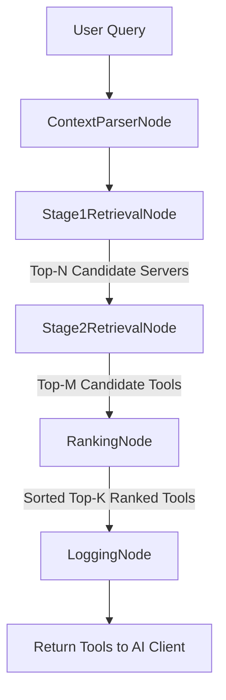

# 🚀 MCP Orchestrator: Dynamic Tool Retrieval & Gateway Middleware

[](https://www.python.org/downloads/)
[](https://github.com/langchain-ai/langgraph)
[](https://modelcontextprotocol.io/)
[](LICENSE)

**MCP Orchestrator** is an enterprise-grade, high-performance gateway middleware positioned between AI coding agents (such as **Claude Code**, **Claude Desktop**, **Cursor**, **Windsurf**, **OpenCode**, **Qwen-Code**, or custom LLM agents) and downstream Model Context Protocol (MCP) servers. 

By replacing upfront static schema preloading with **LangGraph-driven two-stage vector retrieval** and **context-aware 3-term ranking**, MCP Orchestrator achieves a **90.3% reduction in context window token usage** while preserving an **85.0% task execution success rate**.

---

## 📌 Table of Contents
1. [Overview & Problem Statement](#1-overview--problem-statement)
2. [Key Architectural Innovations](#2-key-architectural-innovations)
3. [System Architecture](#3-system-architecture)
4. [LangGraph Query Pipeline](#4-langgraph-query-pipeline)
5. [3-Term Context-Aware Weighted Ranking](#5-3-term-context-aware-weighted-ranking)
6. [Cloning & Local Setup Guide](#6-cloning--local-setup-guide)
7. [Deployment Methods (Python & Docker)](#7-deployment-methods-python--docker)
   - [Method 1: Native Python Execution](#method-1-native-python-execution)
   - [Method 2: Containerized Docker Compose](#method-2-containerized-docker-compose)
8. [MCP Client Connection Guide](#8-mcp-client-connection-guide)
   - [Claude Code (CLI)](#claude-code-cli)
   - [OpenCode & Qwen-Code](#opencode--qwen-code)
   - [Claude Desktop](#claude-desktop)
   - [Cursor & Windsurf](#cursor--windsurf)
9. [Analytics & Evaluation Dashboard](#9-analytics--evaluation-dashboard)
10. [Experimental Evaluation & Benchmark Results](#10-experimental-evaluation--benchmark-results)
11. [Academic Viva & Demonstration Cheatsheet](#11-academic-viva--demonstration-cheatsheet)

---

## 1. Overview & Problem Statement

### The Problem: Context Window Bloat in Large MCP Ecosystems
Standard AI coding agents load **all tool definitions** from every connected downstream MCP server directly into the LLM context window upfront. As an enterprise workspace connects multiple MCP servers (e.g., GitHub, Filesystem, Memory, Jira, Slack, AWS), loading dozens of verbose JSON Schema tool definitions causes:
1. **Context Window Exhaustion**: Thousands of tokens wasted on unused schemas per prompt turn.
2. **Tool Confusion**: LLMs misfire or select sub-optimal tools when overloaded with choices.
3. **Escalating Token Costs**: High per-turn API token fees ($3.00/1M tokens).

### The Solution: Meta-Tool Gateway Pattern
MCP Orchestrator operates as a **dual MCP gateway** (acting as an MCP Client downstream and an MCP Server upstream):
* **Downstream (MCP Client)**: Automatically indexes schemas from connected stdio/SSE servers defined in `mcp_orc.json`.
* **Upstream (MCP Server)**: Exposes **only two lightweight meta-tools** to the AI agent:
  1. `discover_tools(query: string)`: Dynamically retrieves only top-$K$ relevant candidate tool descriptions tailored to the prompt and workspace context.
  2. `invoke_tool(server_id: string, tool_id: string, arguments: object)`: Safely proxies execution to the target downstream MCP server and logs historical success metrics.

---

## 2. Key Architectural Innovations

* **Two-Stage Hybrid Vector Retrieval**:
  * **Stage 1 (Server Retrieval)**: Identifies top candidate MCP servers using semantic embeddings (`all-MiniLM-L6-v2` in ChromaDB) or lexical search.
  * **Stage 2 (Tool Retrieval)**: Filters tools belonging to candidate servers, reducing search space from $N$ total tools to top candidate sets.
* **3-Term Context-Aware Reranking**: Combines Query Similarity, Workspace Project Context Alignment ($\text{ProjMatch}$), and Historical Execution Success ($\text{PastSuccess}$).
* **LangGraph Orchestration**: Declarative 5-node acyclic state graph (`ContextParserNode` $\rightarrow$ `Stage1RetrievalNode` $\rightarrow$ `Stage2RetrievalNode` $\rightarrow$ `RankingNode` $\rightarrow$ `LoggingNode`).
* **Resilient Infrastructure**: Idempotent registration with SQLite/PostgreSQL metadata persistence, minimum relevance thresholding ($\text{MIN\_RELEVANCE\_THRESHOLD} = 0.15$), and graceful fallback degradation.

---

## 3. System Architecture

```
+-----------------------------------------------------------------------------------+
|                            AI CLIENT LAYER                                        |
|  (Claude Code / OpenCode / Qwen-Code / Claude Desktop / Cursor / Windsurf)        |
+-----------------------------------------------------------------------------------+
                                         |
                                (stdio or SSE Transport)
                                         v
+-----------------------------------------------------------------------------------+
|                            MCP ORCHESTRATOR GATEWAY                               |
|                                                                                   |
|  Upstream FastMCP Server (Meta-Tools: discover_tools & invoke_tool)               |
|  ------------------------------------------------------------------------------   |
|  LangGraph Online Execution Pipeline:                                             |
|   1. ContextParserNode  --> Reads workspace (.py, .json, dependencies)            |
|   2. Stage1RetrievalNode --> Top-N MCP Server lookup                              |
|   3. Stage2RetrievalNode --> Top-M Candidate Tool retrieval                       |
|   4. RankingNode         --> 3-Term Weighted Scoring (QuerySim, ProjMatch, Past)  |
|   5. LoggingNode         --> Asynchronous Postgres/SQLite audit logging           |
+-----------------------------------------------------------------------------------+
          |                                      |                         |
    (Local SQLite / Postgres)               (ChromaDB Vector Store)    (Downstream stdio/SSE)
          |                                      |                         |
          v                                      v                         v
+------------------+                   +--------------------+    +----------------------+
| mcp_orchestrator |                   | Vector Collections:|    | Downstream Servers:  |
|   - mcp_servers  |                   |   - "servers"      |    |  - filesystem-server |
|   - mcp_tools    |                   |   - "tools"        |    |  - memory-server     |
|   - query_logs   |                   +--------------------+    |  - github-server     |
|   - tool_logs    |                                             +----------------------+
+------------------+
```

---

## 4. LangGraph Query Pipeline



---

## 5. 3-Term Context-Aware Weighted Ranking

Candidates are scored using the 3-term normalized formula:

$$\text{Score} = w_1 \cdot \text{QuerySim} + w_2 \cdot \text{ProjMatch} + w_3 \cdot \text{PastSuccess}$$

Where:
* $\mathbf{\text{QuerySim}}$: Cosine similarity between user query vector and tool description embedding $[0, 1]$.
* $\mathbf{\text{ProjMatch}}$: Cosine similarity between project workspace context embedding (dependencies, file extensions) and tool embedding $[0, 1]$.
* $\mathbf{\text{PastSuccess}}$: Historical execution success rate tracked in database (default cold-start $= 0.5$).
* **Base Weights**: Default equal weights $w_1 = 0.33, w_2 = 0.33, w_3 = 0.34$. If project context is missing, $w_2=0$ and remaining weights are re-normalized.

---

## 6. Cloning & Local Setup Guide

### Step 1: Clone the Repository
```bash
git clone https://github.com/YourUsername/MCP-Orchestrator.git
cd "MCP Orchestrator"
```

### Step 2: Create Virtual Environment & Install Dependencies
```bash
# Create and activate Python 3.11+ virtual environment
python -m venv venv

# Windows PowerShell:
.\venv\Scripts\Activate.ps1

# Linux / macOS:
source venv/bin/activate

# Install package in editable mode with development dependencies
pip install -e .[dev]
```

### Step 3: Environment & Downstream Server Configuration
1. Copy `.env.example` to `.env`:
   ```bash
   cp .env.example .env
   ```
2. Copy `mcp_orc.example.json` to `mcp_orc.json` to define connected downstream MCP servers:
   ```bash
   cp mcp_orc.example.json mcp_orc.json
   ```

Example `mcp_orc.json`:
```json
{
  "mcpServers": {
    "filesystem-server": {
      "transport": "stdio",
      "command": "npx",
      "args": ["-y", "@modelcontextprotocol/server-filesystem", "."],
      "env": {}
    },
    "memory-server": {
      "transport": "stdio",
      "command": "npx",
      "args": ["-y", "@modelcontextprotocol/server-memory"],
      "env": {}
    },
    "github-server": {
      "transport": "stdio",
      "command": "npx",
      "args": ["-y", "@modelcontextprotocol/server-github"],
      "env": {
        "GITHUB_PERSONAL_ACCESS_TOKEN": "${GITHUB_PERSONAL_ACCESS_TOKEN}"
      }
    }
  }
}
```

### Step 4: Index Downstream Tool Schemas & Embeddings
Execute the idempotent seed registration script to discover downstream tools and populate ChromaDB vector collections:
```bash
python seed_registration.py
```

---

## 7. Deployment Methods (Python & Docker)

You can run MCP Orchestrator using **two deployment modes**:

### Method 1: Native Python Execution

#### A. Standard Input/Output Mode (`stdio`)
Used for local CLI tools (Claude Code, OpenCode, Qwen-Code) and IDE extensions (Cursor, Claude Desktop):
```bash
python -m orchestrator.server --transport stdio
```

#### B. HTTP / Server-Sent Events Mode (`SSE`)
Used for web clients, remote agents, or network connections listening on port `8000`:
```bash
python -m orchestrator.server --transport sse --port 8000
```

---

### Method 2: Containerized Docker Compose

Run the complete multi-container stack (PostgreSQL + ChromaDB + MCP Orchestrator Gateway):

```bash
docker-compose up -d --build
```

This spins up:
* **PostgreSQL Database**: Port `5432` (metadata & invocation audit logs)
* **ChromaDB Vector Store**: Port `8001` (server and tool vector collections)
* **MCP Orchestrator Gateway**: Port `8000` (SSE transport endpoint at `http://localhost:8000/sse`)

To stop the container stack:
```bash
docker-compose down
```

---

## 8. MCP Client Connection Guide

MCP Orchestrator can be integrated into any MCP-compliant AI client using either `stdio` (command launch) or `SSE` (HTTP connection).

### Claude Code (CLI)

Add MCP Orchestrator directly via the Claude Code CLI:

```bash
# Option A: Direct stdio launch (Recommended)
claude mcp add mcp-orchestrator -- python -m orchestrator.server

# Option B: SSE network launch (if gateway is running on port 8000)
claude mcp add mcp-orchestrator --url http://localhost:8000/sse
```

---

### OpenCode & Qwen-Code

For **OpenCode** and **Qwen-Code**, add MCP Orchestrator to your configuration file (e.g., `opencode.json` or `qwen_mcp.json`).

#### Format 1: Standard `mcpServers` Schema
```json
{
  "mcpServers": {
    "mcp-orchestrator": {
      "command": "python",
      "args": ["-m", "orchestrator.server"],
      "env": {
        "PYTHONPATH": "C:/path/to/MCP Orchestrator"
      }
    }
  }
}
```

#### Format 2: `type: "local"` Array Schema
```json
{
  "mcp-orchestrator": {
    "type": "local",
    "command": ["python", "-m", "orchestrator.server"],
    "enabled": true
  }
}
```

---

### Claude Desktop

Edit your `claude_desktop_config.json`:
* **Windows**: `%APPDATA%\Claude\claude_desktop_config.json`
* **macOS**: `~/Library/Application Support/Claude/claude_desktop_config.json`

```json
{
  "mcpServers": {
    "mcp-orchestrator": {
      "command": "python",
      "args": [
        "-m",
        "orchestrator.server"
      ],
      "env": {
        "PYTHONPATH": "C:/path/to/MCP Orchestrator"
      }
    }
  }
}
```

---

### Cursor & Windsurf

1. Open **Cursor Settings** $\rightarrow$ **Features** $\rightarrow$ **MCP**.
2. Click **+ Add New MCP Server**.
3. **Name**: `mcp-orchestrator`.
4. **Type**: `command` (stdio) or `sse`.
5. **Command / URL**:
   * Command: `python -m orchestrator.server`
   * SSE URL: `http://localhost:8000/sse`

---

## 9. Analytics & Evaluation Dashboard

MCP Orchestrator includes a single-page web analytics dashboard for inspecting live metrics, token savings, and ablation F1 charts.

### Start the Dashboard
```bash
python -m uvicorn dashboard.app:app --port 8002
```

Navigate to `http://localhost:8002` in your browser to view:
* **KPI Metrics**: Token Reduction (`90.3%`), Prompt Tokens Saved per turn (`6,724.9`), Task Success Rate (`85.0%`), and Latency (`67.16 ms`).
* **Interactive Chart.js Visualization**: F1@5 scores across all ablation variants.

---

## 10. Experimental Evaluation & Benchmark Results

### 1. Dual-Context Budget Evaluation Results (20 Tasks)

| Metric | Bypass Baseline (Naive Load-All) | Full System ($K=10$ Reference) | **Full System ($K=5$ Budget)** | **Tuned System ($w^*$ Calibration)** |
| :--- | :---: | :---: | :---: | :---: |
| **Exposed Tokens (Avg)** | `7450.0` | `1460.5` | **`725.1`** | **`725.1`** |
| **Context Window Token Red.** | `0.0%` | `80.4%` | **`90.3%`** | **`90.3%`** |
| **Precision @ K** | `0.0286` | `0.1250` | `0.2100` | **`0.2300`** |
| **Recall @ K** | `1.0000` | `0.9250` | `0.8000` | **`0.8500`** |
| **F1 Score @ K** | `0.0554` | `0.2174` | `0.3262` | **`0.3547`** |
| **Task Success Rate** | `90.0%` | `85.0%` | `85.0%` | **`85.0%`** |
| **Recovery Rate** | `90.0%` | `85.0%` | `85.0%` | **`85.0%`** |
| **Ranking Latency** | `2.05 ms` | `64.51 ms` | `67.16 ms` | `67.16 ms` |

---

### 2. Statistical Significance Testing ($K=5$)

* **Top-K Truncation Necessity**: Bypassing Top-K retrieval (`No-Top-K`) causes statistically significant F1 degradation ($p = 0.0455 < 0.05$, Cohen's $d = 0.4873$).
* **Out-of-Sample Weight Calibration**: Leave-One-Out Cross-Validation grid search selected optimal weights **$w_1=0.25, w_2=0.70, w_3=0.05$**, yielding $F1@5 = 0.3547$ (+8.7% relative gain over default weights).
* **Vector Space Equivalence**: Omitting project context (`No-ProjMatch`) and corrupting vector space alignment (`No-Shared-Space`) both yield $F1=0.2976$, confirming that destroying vector space alignment mathematically collapses context signal.

---

## 11. Academic Viva & Demonstration Cheatsheet

When demonstrating this project to advisors or evaluators:

1. **Demonstrate Token Reduction**: Show that preloading 49 tools consumes **7,450 tokens**, whereas MCP Orchestrator exposes only **725 tokens** ($K=5$), achieving a **90.3% token reduction** per turn.
2. **Explain 3-Term Ranking**: Explain how $w_1 \cdot \text{QuerySim} + w_2 \cdot \text{ProjMatch} + w_3 \cdot \text{PastSuccess}$ incorporates real-time workspace context (.py, dependencies) and historical execution feedback.
3. **Show Extensibility**: Open `mcp_orc.json`. Emphasize that adding new downstream MCP tools requires **zero gateway code changes**—simply update JSON definitions.
4. **Show Dashboard**: Launch `python -m uvicorn dashboard.app:app --port 8002` to visually present the ablation chart and benchmark comparison.

---

## 📄 License

Distributed under the **MIT License**. See `LICENSE` for details.
